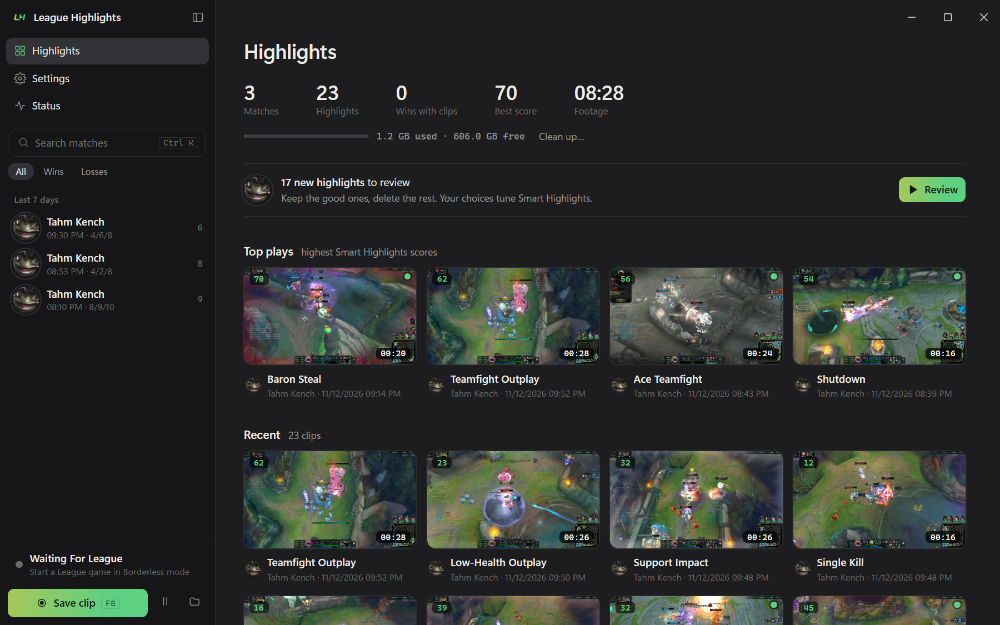
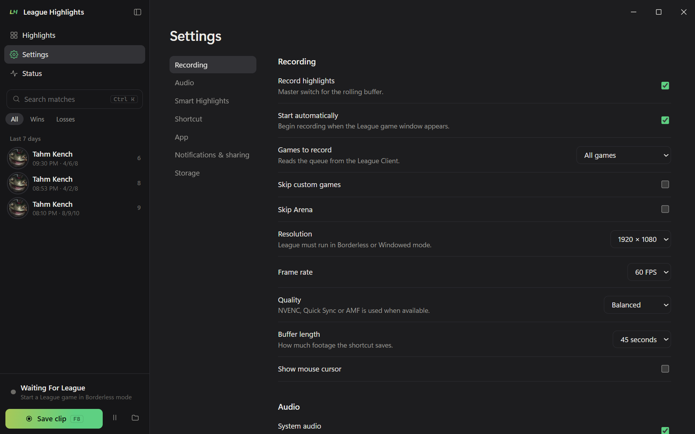
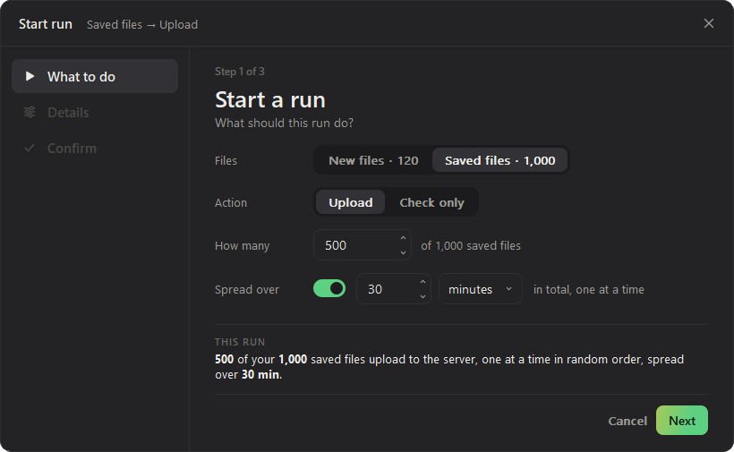
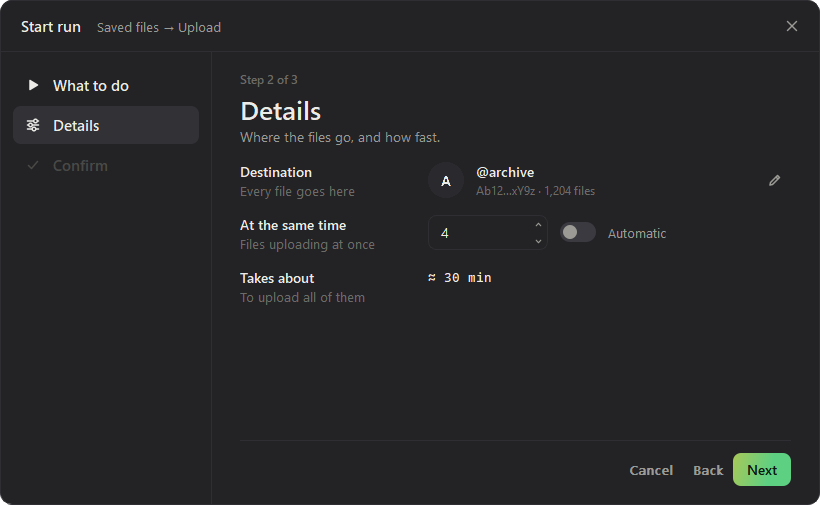
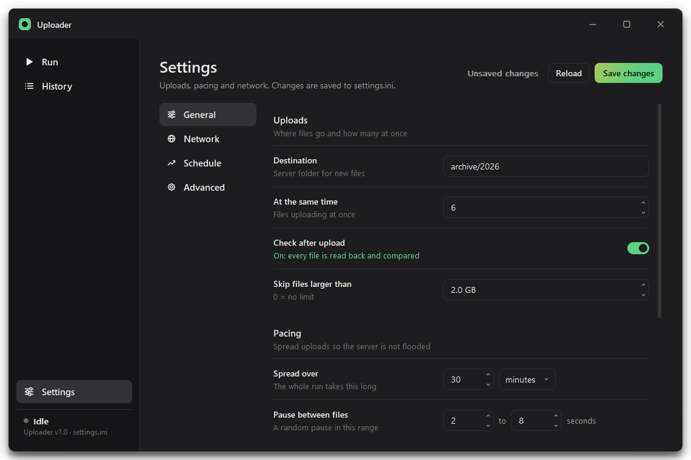
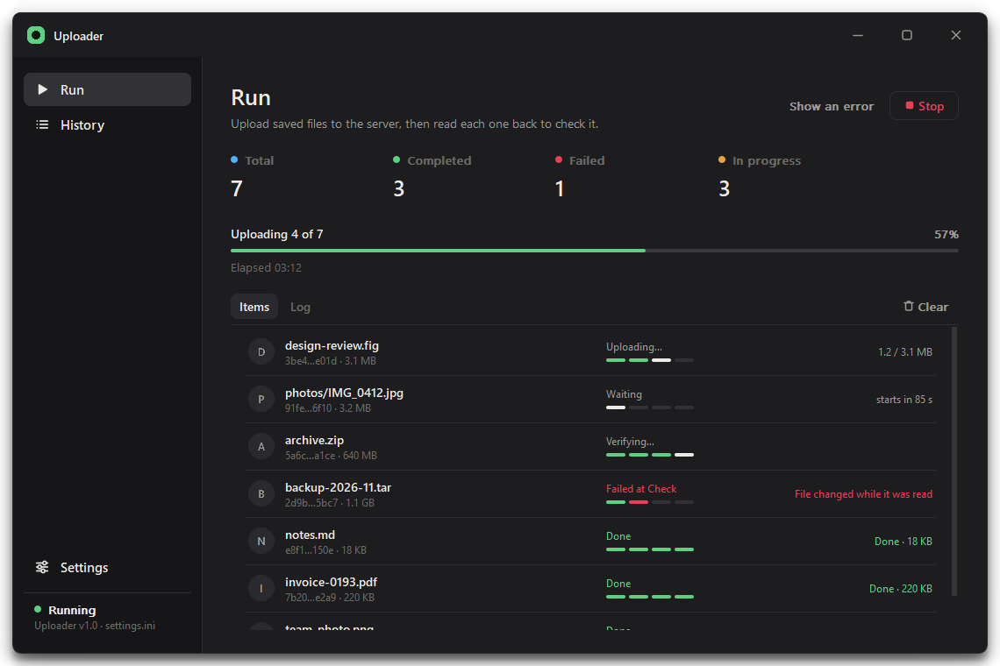
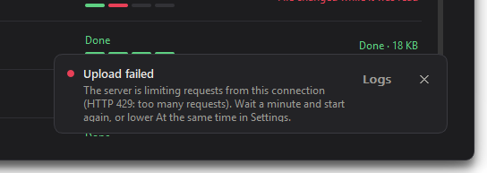

# Quiet desktop UI

A design guide for building app interfaces in the style of
[League Highlights](https://github.com/Kirbyy1/League-Highlights): a calm,
flat, dark-first desktop look with one accent colour. Hand this file to a
designer, a developer or an AI coding assistant and ask for a UI that follows
it.

It covers web views (HTML/CSS) and native Qt apps (PyQt / PySide). The same
tokens and rules apply to both. [Flows and feedback](#flows-and-feedback)
covers tools that run long jobs. For Qt there is a ready-made kit,
[`qt/quiet_ui.py`](qt/quiet_ui.py): copy it into the app instead of
rebuilding the widgets ([Copy the kit](#copy-the-kit)).





## The idea in five rules

1. **Flat, not boxed.** Content sits directly on the page background. Rows are
   separated by spacing or a 1px divider line. Do not wrap settings rows or
   sections in "cards" (a lighter fill with a rounded border).
2. **One accent.** A single accent colour, taken from the logo, marks the primary action, the
   selected item and progress. Everything else is neutral grey.
3. **Text does the work.** Hierarchy comes from size, weight and three text
   tones, not from borders, fills or icons.
4. **Quiet until touched.** Buttons have no fill or border at rest. Hover adds
   a soft fill. Scrollbars are nearly invisible until the pointer is near.
5. **Dense but calm.** 13.5px body text, compact rows, generous space between
   groups.

## Colour tokens

Define every colour as a CSS variable and never hard-code a hex value in a
component. Dark is the default; light follows the system setting.

```css
:root {
  --bg: #1d1d1f;          /* page and title bar */
  --side: #161618;        /* sidebar, one step darker than the page */
  --raise: #232326;       /* floating surfaces: menus, palette, thumbnails */
  --hover: #2a2a2e;       /* hover fill */
  --active: #323236;      /* selected or pressed fill */
  --line: #2e2e33;        /* dividers and input borders */
  --text: #ecebe7;        /* primary text, slightly warm white */
  --muted: #9b9a95;       /* secondary text, resting icons */
  --faint: #6c6b67;       /* captions, metadata, placeholders */
  --accent: #5ed082;      /* the one accent: the logo's green */
  --accent-text: #0b1a10; /* text on an accent fill */
  --good: #5ed082;        /* success, OK status */
  --win: #4cb4ff;         /* a positive result (Victory), distinct from the accent */
  --bad: #e84057;         /* error, destructive, negative result */
  --warn: #e0a83a;        /* warning */
  --track: #3a3a40;       /* slider rails, progress backgrounds */
  --shadow: 0 16px 48px rgba(0, 0, 0, .5);
  color-scheme: dark;
}
@media (prefers-color-scheme: light) {
  :root {
    --bg: #fafaf8; --side: #f1f0ec; --raise: #ffffff; --hover: #e9e8e3;
    --active: #e1e0da; --line: #e3e2dc; --text: #1c1c1e; --muted: #67665f;
    --faint: #9a9990; --accent: #1f8f4d; --accent-text: #fff;
    --good: #1f8f4d; --win: #1f7fd1; --bad: #c62f45; --warn: #a87a1c; --track: #d5d4cc;
    --shadow: 0 16px 48px rgba(40, 35, 20, .18);
    color-scheme: light;
  }
}
```

How to use them:

- Greys are slightly warm. Do not use pure black or pure white for surfaces
  or text.
- Take the accent from the product's logo. To re-skin, change `--accent` and
  `--accent-text` only.
- If the accent is close to a status colour, give that status its own token,
  as `--win` does here, so selection and status never look the same.
- `--good`, `--bad` and `--warn` are for status, never for decoration. Tinted
  status backgrounds use the same colour at about 15% opacity.
- Only floating surfaces (menus, command palette, selection bar) get
  `--raise`, a border and `--shadow`. Nothing in the page flow has a shadow.

## Typography

```css
:root {
  --sans: "Segoe UI Variable Text", "Segoe UI", system-ui, sans-serif;
  --display: "Segoe UI Variable Display", "Segoe UI", system-ui, sans-serif;
  --mono: "Cascadia Code", "Cascadia Mono", Consolas, ui-monospace, monospace;
}
body { font: 13.5px/1.5 var(--sans); -webkit-font-smoothing: antialiased; }
```

System fonts only; no web fonts. On macOS swap in `-apple-system` and
`SF Mono`.

| Role | Style |
|---|---|
| Page title (`h1`) | 600 26px/1.2 display, letter-spacing -0.01em |
| Section title (`h3`) | 600 15px/1.3 display, 34px above, 12px below |
| Hero title | 40px display, on artwork only |
| Body | 400 13.5px/1.5 sans |
| Row title, item name | body size, weight 550 |
| Helper text under a label | 12.5px, `--muted` |
| Caption, metadata, group label | 11.5px, `--faint` |
| Numbers, times, shortcuts, paths | 12px mono with `tabular-nums` |
| Eyebrow (for example a result above a title) | 700 11.5px, uppercase, letter-spacing 0.2em |

Use sentence case everywhere. Weights are 400, 550 and 600 only.

## Layout

```
┌────────────┬───────────────────────────────────────┐
│ brand   ▢  │ title bar (drag area)         ─ ▢ ✕  │ 44px
│ nav        ├───────────────────────────────────────┤
│ search     │                                       │
│ filters    │        content column                 │
│ list       │        max-width 1040px, centred      │
│            │        padding 6px 36px 80px          │
│ ────────── │                                       │
│ status     │                                       │
│ primary    │                                       │
└────────────┴───────────────────────────────────────┘
   276px
```

- **Sidebar**: 276px, `--side` background, a 1px `--line` right border,
  collapsible with a 0.18s slide. Top to bottom: brand row (44px), navigation,
  search field, filter pills, scrolling list, then a footer with status and
  the one primary button.
- **Title bar**: custom, 44px, the same colour as the page so the window reads
  as one surface. Window buttons are 46px wide and square; only Close turns
  red (`#c42b1c`) on hover.
- **Content**: one centred column, never wider than 1040px. Each view fades in
  over 0.16s with a 4px upward move.
- **Spacing scale**: 2, 4, 6, 8, 10, 12, 14, 16, 22, 36px. Inside a group use
  small steps; between groups use 22px or 36px.
- **Below 760px**: the sidebar becomes an overlay, the column padding drops to
  16px, and setting rows wrap.

## Shape

| Element | Radius |
|---|---|
| Buttons, inputs, list rows, menu items | 8–9px |
| Menus, floating bars | 10–12px |
| Thumbnails | 11px |
| Video stage, command palette | 14px |
| Hero banner | 16px |
| Pills, chips, avatars, status dots | fully round |
| Keyboard hints, small badges | 4–5px |

Borders are always 1px `--line`. Icons are 16px outline icons with a 1.5px
stroke, round caps and joins, coloured with `currentColor`.

## Components

### Buttons

```css
button { background: none; border: none; border-radius: 8px; padding: 6px 10px;
  color: var(--muted); display: inline-flex; align-items: center; gap: 7px;
  transition: background .12s, color .12s, opacity .12s; }
button:hover { background: var(--hover); color: var(--text); }
button.on { background: var(--active); color: var(--text); }
button.primary { background: var(--accent); color: var(--accent-text); font-weight: 600; }
button.primary:hover { filter: brightness(1.08); }
button.outline { border: 1px solid var(--line); color: var(--text); }
button:disabled { opacity: .35; pointer-events: none; }
:focus-visible { outline: 2px solid var(--accent); outline-offset: 1px; }
```

- **Ghost** (default): no fill, no border. Use for almost everything.
- **Outline**: a 1px border. Use for secondary actions that sit next to
  content, such as "Fix" in a checklist row.
- **Primary**: a solid accent fill, never a gradient. One per screen at most.
- **Icon button**: 32×32px, icon centred, always with a tooltip.
- **Destructive**: ghost or outline with `--bad` text; never a red fill.

### Inputs

Text fields and selects are transparent with a 1px `--line` border, 8px
radius and 6px 10px padding. Checkboxes and sliders use
`accent-color: var(--accent)`. A slider shows its value beside it in mono.

### List rows (sidebar)

A row is a 34px round avatar, a two-line text block and a faint count on the
right, with 6px 8px padding and a 9px radius. Hover uses `--hover`, selected
uses `--active`. The first line is the name at weight 550; the second line is
11.5px `--faint` metadata joined with " · ", starting with whatever tells
similar rows apart (for example the time). Rows are grouped under small faint
labels such as "Today" and "Yesterday". An avatar can carry a 1.5px status
ring in `--win` or `--bad`.

### Setting rows

```html
<div class="set">
  <div class="l"><div>Microphone</div><div class="h">Mixed in only when a clip is saved.</div></div>
  <div class="c"><input type="checkbox"></div>
</div>
```

```css
.set { display: flex; align-items: center; justify-content: space-between;
  gap: 18px; padding: 12px 0; border-bottom: 1px solid var(--line); }
.set .h { color: var(--muted); font-size: 12.5px; }
```

Label and helper on the left, one control on the right, a divider below. No
background, no box. Group rows under an `h3`. A settings page has a sticky
160px category list on the left and the rows on the right.

### Checklist and key-value rows

Same flat pattern: a 22px round status badge (tinted background, coloured
check or warning icon), a title with a muted detail line, and an optional
outline button. Key-value details use a two-column grid (190px label column)
with a divider under each row and values in mono.

### Stats

Big numbers without boxes: a row of items 48px apart, each a 26px display
number above a 12px faint label.

### Media tiles

A grid with `repeat(auto-fill, minmax(216px, 1fr))` and a 16px 14px gap. Each
tile is a 16:9 thumbnail (11px radius, 1px line ring) with a caption below:
title at weight 550 and a faint metadata line. Overlays on the thumbnail are
small mono badges on `rgba(0,0,0,.72)`: duration bottom-right, score top-left,
an accent dot for "new". Hover zooms the image to 1.04 and fades in a play
icon. Selected tiles get a 2px accent ring.

### Hero banner

A 290px banner with a 16px radius, artwork as a cover background and a dark
gradient from the bottom and left for legibility. Bottom-left: an uppercase
eyebrow, a 40px title, then a row of translucent mono chips
(`rgba(255,255,255,.1)` with an 8px blur). This is the one place where rich
imagery is used. Without artwork it collapses to a plain title and chips.

### Chips and pills

- **Filter pills**: 12px text, 2px 10px padding, fully round, ghost style;
  the active one uses `--active`.
- **Info chips**: 12px, `--hover` background, `--muted` text, fully round.

### Menus, command palette, toast

- **Menu**: `--raise` background, 1px border, 10px radius, 4px padding,
  `--shadow`. Items are full-width ghost buttons, optionally with a small
  faint description line.
- **Command palette** (Ctrl+K): a 580px box 13vh from the top over a
  `rgba(0,0,0,.4)` backdrop, with a borderless 15px input and a list where the
  selected item uses `--active`.
- **Toast**: inverted colours (`--text` background, `--bg` text), 10px radius,
  bottom centre, fades and rises 8px. One short line, no buttons.
- **Selection bar**: floating bottom-centre bar on `--raise` with a count and
  ghost actions.

### Status and progress

- **Status dot**: 9px circle; grey idle, `--good` ok, `--warn` problem, and
  `--bad` with a soft pulsing ring while active (for example recording).
- **Progress bars and rails**: 3–4px tall, `--track` background, `--accent`
  fill, 2px radius.
- **Keyboard hints**: `<kbd>` in 11px mono with a 1px border and a 4px radius,
  shown next to the action they trigger.

### Scrollbars

```css
::-webkit-scrollbar { width: 10px; height: 10px; }
::-webkit-scrollbar-track, ::-webkit-scrollbar-corner { background: transparent; }
::-webkit-scrollbar-button { display: none; }
::-webkit-scrollbar-thumb { background-color: transparent; border: 3px solid transparent;
  border-radius: 10px; background-clip: padding-box; min-height: 40px; }
:hover::-webkit-scrollbar-thumb { background-color: color-mix(in srgb, var(--text) 18%, transparent); }
::-webkit-scrollbar-thumb:hover { background-color: color-mix(in srgb, var(--text) 32%, transparent); border-width: 2px; }
```

Invisible at rest, faint while the pointer is over the scrolling area, clearer
when hovered. No arrow buttons, no track.

### Toggle switch

For on/off settings, use a switch instead of a checkbox. It is 36×20px and
fully round. The track fades from `--track` to `--accent`. The knob is
(height − 6)px, inset 3px, and fades from `--muted` to `--bg` as it slides,
over 0.12s. A disabled switch is drawn at 35% opacity. Keep checkboxes for
lists of items you can pick.

### Segmented control

Use it for a short choice of two to four options, side by side. The track is
one step darker than the page (`#1b1b1e`), with a 10px radius and 3px
padding. Each segment is a ghost button (5px 14px, 8px radius), and the
chosen one uses `--active`. A segment can carry a count: "Saved files ·
1,000".

### Distribution bar

This shows how something is split, for example 20% / 30% / rest. It is an
8px bar with a 4px radius and a `--track` background, filled left to right
with one colour per part. Parts are separated by a 2px gap line in `--raise`.
Put the legend under the bar as faint text, one colour dot per part.

## Flows and feedback

These patterns are for tools that start long jobs: batch runs, sync, export.
The rule behind all of them: **before the start, the user knows what will
happen, how long it takes and what it costs. While it runs, they can see
each item. At the end, the summary is honest.**

### Stepped dialog

Use this for a job that needs more than one screen of choices.



- **Frame:** a frameless, modal window on `--raise`, with a 1px `--line`
  border and a 12px radius, at least 820px wide.
- **Header:** the title on the left (15px, weight 600). Next to it, a muted
  breadcrumb of what was picked, such as "Saved files → Upload to the
  server". A close button sits on the right, and a divider runs below.
- **Step list:** a 210px column on the left, like the settings categories.
  It uses nav buttons with 16px icons, the current one in `--active`. Steps
  you have already reached can be clicked. A 1px vertical divider separates
  it from the content.
- **Content:** a faint "Step 1 of 3" (12px, weight 600), then the page title
  (26px) and a one-line subtitle.
- **Footer:** a divider, then a message area on the left that grows. On the
  right, ghost Cancel and Back buttons and one primary button. The primary
  button says "Next" until the last step, where it names the job, such as
  "Start run".
- **Keys:** number keys pick the options on step 1, and Enter presses the
  primary button.

### Ask questions, then say what will happen

Do not show a long list of similar options. Ask one or two short questions,
each with a segmented control ("Files: New · Saved", then "Action: Upload ·
Check"). Below them, after a divider and an eyebrow label such as "THIS RUN",
write one plain sentence that says exactly what will happen:

> 500 of your 1,000 files that changed in the last 30 days upload to the
> server, one at a time in random order, spread over 30 minutes.

Update the sentence on every change, and bold the key numbers in it.

### Show time and cost before the start

- Show a "Takes about" row in mono with "≈": "≈ 2 h 38 min".
- Show a "This run costs" row with the amount right-aligned in mono.
- If the user asks for something that cannot fit, explain why in the summary
  instead of failing later: "Each upload takes about 3 s, so 500 take at
  least 25 min."
- Write rough durations in one or two units only: "45 s", "12 min",
  "1 h 46 min", "2 days 3 h".

### Number inputs people can read

- **Durations:** a number and a unit picker (seconds / minutes / hours), not
  raw seconds. When loading a saved value, pick the largest unit that keeps it
  a whole number, so 1800 s shows as 30 minutes.
- **Part of a whole:** "How many [500] of 1,000 files". The total sits in
  muted text beside the box, and the box's range is capped at the total. If
  the same number appears on two steps, it is one value: changing one changes
  the other.
- **Ranges:** "[30] to [120] seconds". Raising the minimum past the maximum
  moves the maximum with it.
- Spin boxes and dropdowns ignore the mouse wheel unless they have focus, so
  scrolling the page never changes a value.

### Off keeps the numbers

An optional feature (a delay, a limit) gets a switch in front of its fields.
Switching it off hides the fields but keeps their values for next time.
Switching it on with empty fields fills in a sensible default. A muted note
beside the switch says what the current state means: "Off: each file
uploads right away" or "random per file". On a settings row, the help line
can show the state: `--good` when on, `--warn` when off matters.

### Look it up as it is typed

For a field that names something real (a profile, an address, a file), look
it up 600ms after typing stops. When it is found, replace the field with a
chip: a 36px round picture (the first letter on `--hover` if there is no
picture), the name at weight 600, a faint line such as "Ab12…xY9z · 1,204
followers", and a 32px pencil button that brings the field back. If the
lookup fails, show one line in `--bad` under the field.



### Save state in settings

Settings save on a button, never on every keystroke. The page header holds
the title and subtitle on the left. On the right are a status text, an
outline "Reload" button and a primary "Save changes" button.

| State | Status text | Tone |
|---|---|---|
| Nothing changed | (hidden), Save disabled | — |
| Edited | "Unsaved changes" | `--muted` |
| Problems | "2 issues to review"; a click jumps to the first, the tooltip lists all | `--warn` |
| Just saved | "All changes saved" for about 2s | `--good` |

Before leaving a page with unsaved changes, ask whether to save or discard
them.



### Live run list

While a job runs, show one row per item, newest on top, with a divider
between rows:

- On the left, a 30px round avatar (with a first-letter fallback). Next to
  it, the name at weight 600 and a faint short id.
- In the middle, a 150px column with the current step ("Uploading…") above a
  **step track**. The track is one 22×4px segment per step with 4px gaps and
  a 2px radius. Done steps are `--good`, the current step is `--text`, a
  failed step is `--bad`, and steps still to come are `--active`. The
  tooltip lists the steps: "Read → Check → Upload → Verify".
- On the right, the result, right-aligned in a fixed 210px column so every
  row's track lines up: "Done" or "Done · verifies in 85 s" in `--good`, or
  the short error in `--bad`. A longer error is cut with "…", and the full
  text goes in the tooltip.
- When the list is empty, show one centred muted line: "Items show here
  once you start a run."

Above the list, show a stats row: flat stats, each with a status dot, a
label and a 26px number. Total uses `--win`, Completed `--good`, Failed
`--bad` and In progress `--warn`. Use tabs ("Items · Log") to switch
between the list and the raw log.



### Start, stop, and the end line

- The primary "Start run" button turns into an outline `--bad` "Stop" while
  the job runs. Stop asks for confirmation, then the status shows
  "Stopping…" in `--warn` while the items already in hand finish.
- The sidebar footer shows the app state: a status dot and "Idle" (faint),
  "Running" (`--good`) or "Stopping…" (`--warn`). Below it is a faint line
  with the version and the config file.
- End with one honest line, joined with " · ": "uploaded 12/80 · 3 failed ·
  65 not done (stopped)". Items that were never tried are "not done", not
  failures.
- If the app was closed mid-job and left something to clean up, offer to
  finish it on the next start, with "Do it now" and "Later" buttons.

### Errors

- Rewrite errors in plain words before showing them. "HTTP 429" becomes
  "The server is limiting requests from this connection. Wait a minute and
  start again." Keep the raw text in the log file.
- **Error note:** a 440px note in the bottom-right corner, 30px from the
  edges, on `--raise` with a 1px border and a 10px radius. It has an 8px
  `--bad` dot, a title at weight 600, the message in selectable 12px text,
  and two ghost buttons: "Logs" (opens the log folder) and ✕. It stays about
  20s, and while the pointer is over it, it stays. This is separate from the
  one-line info toast.



### Secrets

Show a key or password field masked, with a ghost "Show" / "Hide" toggle
next to it. The placeholder says where the secret goes, such as "kept in
memory for this run only". Never write a secret into a settings file or a
log.

## Motion

- Colour and opacity changes: 0.12s.
- View changes and overlays: 0.12–0.18s ease, with at most a 4–8px move.
- Image hover zoom: 0.25s.
- Nothing bounces, and nothing loops except the active status dot.

## Writing

- Sentence case for every label, button and heading.
- Buttons say what they do: "Save clip", "Open folder".
- Helper text is one short plain sentence under the label.
- Join metadata with " · ". Put numbers, times and paths in mono.
- Empty states are a centred title and one line on what to do next.
- Labels are short questions or nouns ("How many", "At the same time",
  "Takes about"). The helper line under each one says what it is for ("Of the
  files above").
- Say what will happen in a sentence, not with a table of flags. Say what a
  job did in one honest line.
- Write a shortened id with an ellipsis in the middle, such as "Ab12…xY9z".
  Write counts with thousands separators, such as "1,000".

## Do and don't

| Do | Don't |
|---|---|
| Put rows on the page background with a divider | Wrap rows or sections in cards |
| Use one accent for the one primary action | Use several coloured buttons on a screen |
| Show hierarchy with text size, weight and tone | Add borders and fills to create hierarchy |
| Keep buttons ghost until hovered | Give every button a fill or outline |
| Use `--good` / `--bad` only for real status | Colour things for decoration |
| Use shadows only on floating surfaces | Put shadows or gradients on page content or buttons |
| Use system fonts and outline icons | Add web fonts, emoji or filled icon sets |
| Use a boxed panel only for real emphasis, and sparingly | Box things by default |
| Show time, cost and a plain summary before a job starts | Find out what it does after pressing Start |
| Let people type time as a number and a unit | Ask for raw seconds |
| Count stopped items as "not done" | Report items that were never tried as failed |
| Ignore the mouse wheel on unfocused number boxes | Let page scrolling change values |

## Starter page

```html
<body>
  <aside id="side">
    <div class="brand"><b>App name</b></div>
    <nav class="navs">
      <button class="on">Home</button>
      <button>Settings</button>
    </nav>
    <div id="list"><!-- grouped list rows --></div>
    <div class="foot"><button class="primary">Main action <kbd>F8</kbd></button></div>
  </aside>
  <main id="main">
    <div class="top"><!-- drag area and window buttons --></div>
    <div id="scroll">
      <div class="col">
        <h1>Settings</h1>
        <h3>Audio</h3>
        <div class="set">
          <div class="l"><div>Microphone</div><div class="h">Mixed in only when a clip is saved.</div></div>
          <div class="c"><input type="checkbox"></div>
        </div>
      </div>
    </div>
  </main>
</body>
```

```css
body { margin: 0; height: 100vh; display: flex; overflow: hidden;
  background: var(--bg); color: var(--text); }
#side { width: 276px; flex: none; background: var(--side);
  border-right: 1px solid var(--line); display: flex; flex-direction: column; }
#main { flex: 1; min-width: 0; display: flex; flex-direction: column; }
.top { height: 44px; flex: none; }
#scroll { flex: 1; overflow-y: auto; scrollbar-gutter: stable; }
.col { max-width: 1040px; margin: 0 auto; padding: 6px 36px 80px; }
```

## Building it in Qt

### Copy the kit

[`qt/quiet_ui.py`](qt/quiet_ui.py) is the whole look as one module: the
stylesheet, the painted widgets and every pattern in
[Flows and feedback](#flows-and-feedback). It works with PySide6 or PyQt5.

1. Copy `qt/quiet_ui.py` into the app **as it is**. Do not rewrite or
   "simplify" its widgets. That is how the popup and the rest come out
   exactly like the screenshots.
2. Build the pages from its widgets. Change colours only in `TOKENS`, and
   swap `app_mark()` for the app's logo.
3. Run [`qt/demo.py`](qt/demo.py) to see every widget working, and
   [`qt/test_quiet_ui.py`](qt/test_quiet_ui.py) to check it still behaves.

| Need | Use |
|---|---|
| Window with title bar, sidebar and pages | `make_app()`, `QuietWindow`, `add_page()`, `Page`, `set_status()` |
| Settings page | `CategoryView`, `SettingsSection.add_row()`, `SaveState` |
| Popup set up in steps | `StepDialog.add_step()`, `form_grid()`, `form_label()`, `detail_grid()`, `summary_block()`, `OptionList` |
| Choices | `Segmented`, `Segmented(..., tabs=True)`, `ToggleSwitch`, `NoWheelComboBox` |
| Numbers | `NoWheelSpinBox`, `NoWheelDoubleSpinBox`, `DurationInput`, `CountOf`, `RangeInput` |
| A field that is looked up | `LookupField` (shows a `Chip` once found) |
| A running job | `Stat`, `stats_row()`, `ItemList`, `ItemRow.set_progress()`, `log_view()`, `QProgressBar` |
| Errors | `QuietWindow.show_error()` (an `ErrorNote`) |
| Buttons | `button(text, "primary" / "secondary" / "danger" / "ghost", icon_kind)`, `set_button_kind()` |
| Text | `label(text, kind)` with kinds such as `PageTitle`, `RowLabel`, `RowHelp`, `Note`, `MonoValue`, `Eyebrow`, `MetaText` |
| Small helpers | `icon()`, `set_state()`, `rough_duration()`, `short_id()`, `DistributionBar`, `legend()`, `run_dialog()` |

```python
from quiet_ui import (CategoryView, NoWheelSpinBox, Page, QuietWindow, QVBoxLayout, QWidget,
                      SaveState, Segmented, SettingsSection, StepDialog, button, form_grid,
                      form_label, make_app, run_app, run_dialog, summary_block)

app = make_app()
win = QuietWindow("My app")

run = Page("Run", "Upload saved files to the server.")
start = run.add_action(button("Start run", "primary", "play"))
win.add_page("Run", "play", run)

settings = Page("Settings", "Changes are saved to settings.ini.")
save = button("Save changes", "primary")
state = SaveState(save)                     # "Unsaved changes", issues, "All changes saved"
settings.add_action(state)
settings.add_action(save)
uploads = SettingsSection("Uploads", "Where files go and how many at once")
workers = NoWheelSpinBox(1, 64, 4)
uploads.add_row("At the same time", "Files uploading at once", workers)
workers.valueChanged.connect(lambda _v: state.set_dirty(True))
save.clicked.connect(lambda _=False: state.flash_saved())
categories = CategoryView()
categories.add("General", "sliders", [uploads])
settings.body.addWidget(categories)
win.add_page("Settings", "sliders", settings, bottom=True)


def start_run() -> None:
    dialog = StepDialog("Start run", finish_text="Start run", parent=win)
    page = QWidget()
    lay = QVBoxLayout(page)
    lay.setContentsMargins(0, 0, 0, 0)
    grid = form_grid()
    grid.addWidget(form_label("Action"), 0, 0)
    grid.addWidget(Segmented(["Upload", "Check only"]), 0, 1)
    lay.addLayout(grid)
    block, summary = summary_block("THIS RUN")
    summary.setText("<b>500</b> of your <b>1,000</b> files upload to the server.")
    lay.addWidget(block)
    lay.addStretch()
    dialog.add_step("What to do", page, "Start a run", "What should this run do?", "play")
    if run_dialog(dialog):
        win.set_status("Running", "good")


start.clicked.connect(lambda _=False: start_run())
win.show()
run_app(app)
```

The rest of this section explains how the kit is built. Read it when you
change the kit, not before using it.

### How the kit styles Qt

Put the tokens in one stylesheet (QSS) applied to the `QApplication`, and
target widgets by `objectName` (`#PrimaryButton`, `#RowHelp`). For states,
use a dynamic property such as `[state="ok"]`. After changing it, re-polish
the widget (`w.style().unpolish(w); w.style().polish(w)`, which is
`set_state()` in the kit), or the new style will not show.

### Window

- Make the window frameless (`Qt.FramelessWindowHint` and
  `WA_TranslucentBackground`) with an inner `#WindowFrame` on `--bg`, a 1px
  `--line` border and a 10px radius. When maximized, set the frame's
  `maximized` property and drop the radius and border.
- **Title bar:** 50px tall, transparent, and draggable. Double-clicking it
  maximizes the window. It holds a 20px logo and the app name at weight 600.
- **Window buttons:** 46×32px, drawn with `QPainter` using a 1.4px
  round-capped pen. Hover fills `--hover`; for Close only, hover fills
  `#c42b1c`.
- Add an invisible 18px `QSizeGrip` in the bottom-right corner so the
  frameless window can still be resized.
- **Sidebar for a tool app** (one with no item list): 216px wide. The main
  pages go at the top. After a stretch come Settings and then the status
  footer, which has a top divider.

### Type in Qt

- Qt draws `px` sizes slightly smaller than a browser. Use 14px for body
  text, 13px for helper text and 12px for captions.
- `font-weight: 600` is unreliable with Segoe UI in QSS. Use
  `font-family: "Segoe UI Semibold"; font-weight: normal;` for every 600
  style.
- Mono text (logs, amounts, times) uses `"Cascadia Mono", "Consolas",
  monospace` at 13px.
- Off Windows, the kit uses `system-ui` with `font-weight: 600` instead.

### Stylesheet core

`stylesheet()` in the kit holds the full version. This is the core, for
reference:

```css
* { font-family: "Segoe UI", sans-serif; font-size: 14px; color: #ecebe7; outline: none; }

QLineEdit, QSpinBox, QDoubleSpinBox, QComboBox {
    background: transparent; border: 1px solid #2e2e33; border-radius: 8px;
    padding: 6px 10px; min-height: 20px;
    selection-background-color: #5ed082; selection-color: #0b1a10;
}
QLineEdit:hover, QSpinBox:hover, QComboBox:hover { border-color: #3a3a40; }
QLineEdit:focus, QSpinBox:focus, QComboBox:focus { border-color: #5ed082; }
QLineEdit[invalid="true"] { border-color: #e84057; }
QLineEdit:disabled, QSpinBox:disabled, QComboBox:disabled { color: #6c6b67; }

#PrimaryButton {
    background: #5ed082;
    color: #0b1a10; border: none; border-radius: 8px; padding: 7px 14px;
    font-family: "Segoe UI Semibold"; font-weight: normal;
}
#PrimaryButton:hover { background: #6ddb90; }
#PrimaryButton:disabled { background: #2a2a2e; color: #6c6b67; }
#SecondaryButton { background: transparent; border: 1px solid #2e2e33; border-radius: 8px; padding: 6px 12px; }
#SecondaryButton:hover { background: #2a2a2e; border-color: #3a3a40; }
#DangerButton { background: transparent; color: #e84057; border: 1px solid #2e2e33; border-radius: 8px; padding: 6px 14px; }
#GhostButton { background: transparent; border: none; border-radius: 8px; color: #9b9a95; padding: 6px 10px; font-size: 13px; }
#GhostButton:hover { background: #2a2a2e; color: #ecebe7; }

#NavButton { background: transparent; border: none; border-radius: 8px; text-align: left;
    padding: 9px 12px; font-size: 15px; }
#NavButton:hover { background: #2a2a2e; }
#NavButton:checked { background: #323236; }

#SettingRow { background: transparent; }            /* rows stay flat */
#RowLabel { font-family: "Segoe UI Semibold"; }
#RowHelp { color: #6c6b67; font-size: 13px; }
#Divider { background: #2e2e33; min-height: 1px; max-height: 1px; border: none; }

QProgressBar { background: #3a3a40; border: none; border-radius: 2px; min-height: 4px; max-height: 4px; }
QProgressBar::chunk { background: #5ed082; border-radius: 2px; }

QScrollArea { background: transparent; border: none; }
QScrollArea > QWidget > QWidget { background: transparent; }
QScrollBar:vertical { background: transparent; width: 10px; margin: 2px; }
QScrollBar::handle:vertical { background: rgba(236,235,231,30); border-radius: 4px; min-height: 40px; }
QScrollBar::handle:vertical:hover { background: rgba(236,235,231,80); }
QScrollBar::add-line, QScrollBar::sub-line { height: 0; width: 0; }
QScrollBar::add-page, QScrollBar::sub-page { background: none; }

QMenu { background: #232326; border: 1px solid #2e2e33; border-radius: 8px; padding: 4px; }
QMenu::item { padding: 6px 14px; border-radius: 6px; font-size: 13px; }
QMenu::item:selected { background: #323236; }
QToolTip { background: #2a2a2e; border: 1px solid #3a3a40; border-radius: 6px; padding: 6px 8px; }
```

### Things QSS cannot draw

- **Checkmark and arrows:** QSS cannot draw an icon. Paint the check
  (`#0b1a10`, 4.5px round pen on a 36×36 pixmap) and the spin box and
  dropdown chevrons (`--muted`) once at start-up. Save them as PNGs in the
  temp folder and put their paths into the stylesheet's `image: url(...)`.
- **Dropdown popup:** give the combo a `QListView`. Make the popup window
  frameless with no shadow, on `--raise` with a 1px border. Make the items
  28px tall with an 8px radius, and use `combobox-popup: 0` so it opens as a
  list.
- **Toggle switch:** a `QCheckBox` subclass that paints its track and knob
  and animates between them over 0.12s (`ToggleSwitch`).
- **Round avatars:** draw at 3× size into a pixmap clipped by an ellipse,
  then call `setDevicePixelRatio(3)` so they stay sharp. With no picture,
  draw the first letter on `--hover`.
- **Step track and distribution bar:** paint them with `QPainter` too (see
  [Live run list](#live-run-list) and [Distribution bar](#distribution-bar)).
- **No-wheel inputs:** subclass `QSpinBox`, `QDoubleSpinBox` and `QComboBox`.
  Give them `Qt.StrongFocus`, and in `wheelEvent` call `e.ignore()` unless the
  widget has focus.
- **Status dot:** a fixed-size `QLabel` with
  `background-color: <colour>; border-radius: <size/2>px`.
- **Focus between steps:** when `StepDialog` changes step, focus moves to
  the primary button first. Otherwise it falls into the first field of the
  new step and leaves that field's text selected.
- **Error note height:** a word-wrapped label inside a floating frame needs
  `heightForWidth()` to size it. `adjustSize()` alone cuts the text to one
  line.

### Long work off the UI thread

Run every network call and job in a `QThread` and send progress back with
signals. The window never freezes, and Stop sets a flag the worker checks
between items, including while it waits.

## Prompt for an AI assistant

> Build this UI following DESIGN.md. Use its colour tokens and type scale
> exactly. Keep content flat on the page background with divider lines, not
> cards. Use ghost buttons, one accent-filled primary action per screen,
> system fonts, 16px outline icons, and shadows only on floating menus.
> Before a job starts, show a plain summary of what it will do, how long it
> takes and what it costs. While it runs, show each item with a step track.
> For a Qt app, copy qt/quiet_ui.py into the project unchanged and build
> every page, dialog and popup from its widgets (QuietWindow, Page,
> SettingsSection, StepDialog, ItemList, ErrorNote). Do not restyle or
> rewrite them. The result should match the screenshots in images/.

## Reference

- **Web:** the full working implementation is a single file,
  [`ui/index.html`](https://github.com/Kirbyy1/League-Highlights/blob/main/ui/index.html)
  in League Highlights.
- **Qt:** [`qt/quiet_ui.py`](qt/quiet_ui.py) is the kit,
  [`qt/demo.py`](qt/demo.py) is a working app built with it (run
  `python demo.py --shots DIR` to re-create the screenshots), and
  [`qt/test_quiet_ui.py`](qt/test_quiet_ui.py) holds its tests.
