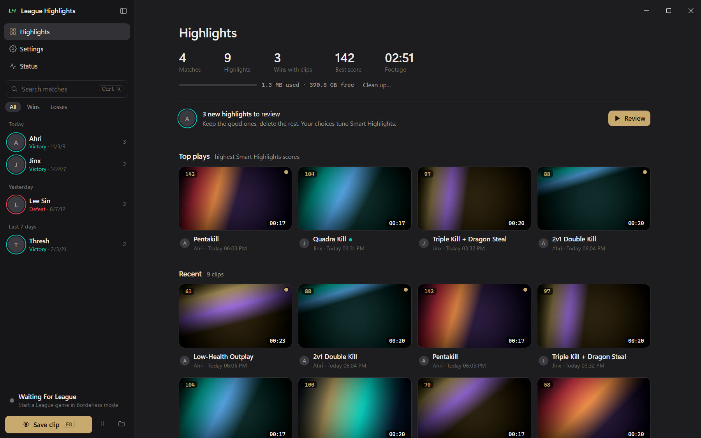
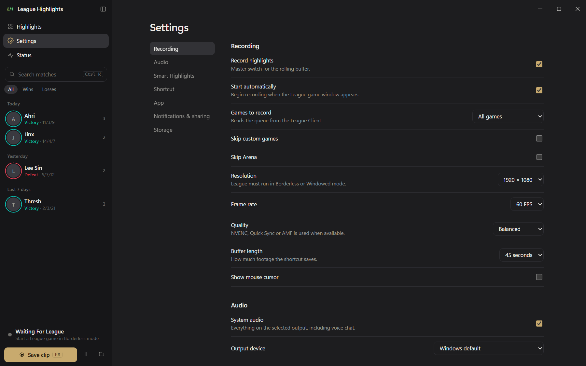

# Quiet desktop UI

A design guide for building app interfaces in the style of
[League Highlights](https://github.com/Kirbyy1/League-Highlights): a calm,
flat, dark-first desktop look with one accent colour. Hand this file to a
designer, a developer or an AI coding assistant and ask for a UI that follows
it.





## The idea in five rules

1. **Flat, not boxed.** Content sits directly on the page background. Rows are
   separated by spacing or a 1px divider line. Do not wrap settings rows or
   sections in "cards" (a lighter fill with a rounded border).
2. **One accent.** A single accent colour marks the primary action, the
   selected item and progress. Everything else is neutral grey.
3. **Text does the work.** Hierarchy comes from size, weight and three text
   tones, not from borders, fills or icons.
4. **Quiet until touched.** Buttons have no fill or border at rest. Hover adds
   a soft fill. Scrollbars are nearly invisible until the pointer is near.
5. **Dense but calm.** 13.5px body text, compact rows, generous space between
   groups.

## Colour tokens

Define every colour as a CSS variable and never hard-code a hex value in a
component. Dark is the default; light follows the system setting.

```css
:root {
  --bg: #1d1d1f;          /* page and title bar */
  --side: #161618;        /* sidebar, one step darker than the page */
  --raise: #232326;       /* floating surfaces: menus, palette, thumbnails */
  --hover: #2a2a2e;       /* hover fill */
  --active: #323236;      /* selected or pressed fill */
  --line: #2e2e33;        /* dividers and input borders */
  --text: #ecebe7;        /* primary text, slightly warm white */
  --muted: #9b9a95;       /* secondary text, resting icons */
  --faint: #6c6b67;       /* captions, metadata, placeholders */
  --accent: #c8aa6e;      /* the one accent (muted gold here) */
  --accent-text: #1a1508; /* text on an accent fill */
  --good: #0ac8b9;        /* success, positive result */
  --bad: #e84057;         /* error, destructive, negative result */
  --warn: #e0a83a;        /* warning */
  --track: #3a3a40;       /* slider rails, progress backgrounds */
  --shadow: 0 16px 48px rgba(0, 0, 0, .5);
  color-scheme: dark;
}
@media (prefers-color-scheme: light) {
  :root {
    --bg: #fafaf8; --side: #f1f0ec; --raise: #ffffff; --hover: #e9e8e3;
    --active: #e1e0da; --line: #e3e2dc; --text: #1c1c1e; --muted: #67665f;
    --faint: #9a9990; --accent: #9a7a3a; --accent-text: #fff;
    --good: #078c82; --bad: #c62f45; --warn: #a87a1c; --track: #d5d4cc;
    --shadow: 0 16px 48px rgba(40, 35, 20, .18);
    color-scheme: light;
  }
}
```

How to use them:

- Greys are slightly warm. Do not use pure black or pure white for surfaces
  or text.
- To re-skin for another product, change `--accent` and `--accent-text` only.
- `--good`, `--bad` and `--warn` are for status, never for decoration. Tinted
  status backgrounds use the same colour at about 15% opacity.
- Only floating surfaces (menus, command palette, selection bar) get
  `--raise`, a border and `--shadow`. Nothing in the page flow has a shadow.

## Typography

```css
:root {
  --sans: "Segoe UI Variable Text", "Segoe UI", system-ui, sans-serif;
  --display: "Segoe UI Variable Display", "Segoe UI", system-ui, sans-serif;
  --mono: "Cascadia Code", "Cascadia Mono", Consolas, ui-monospace, monospace;
}
body { font: 13.5px/1.5 var(--sans); -webkit-font-smoothing: antialiased; }
```

System fonts only; no web fonts. On macOS swap in `-apple-system` and
`SF Mono`.

| Role | Style |
|---|---|
| Page title (`h1`) | 600 26px/1.2 display, letter-spacing -0.01em |
| Section title (`h3`) | 600 15px/1.3 display, 34px above, 12px below |
| Hero title | 40px display, on artwork only |
| Body | 400 13.5px/1.5 sans |
| Row title, item name | body size, weight 550 |
| Helper text under a label | 12.5px, `--muted` |
| Caption, metadata, group label | 11.5px, `--faint` |
| Numbers, times, shortcuts, paths | 12px mono with `tabular-nums` |
| Eyebrow (for example a result above a title) | 700 11.5px, uppercase, letter-spacing 0.2em |

Use sentence case everywhere. Weights are 400, 550 and 600 only.

## Layout

```
┌────────────┬───────────────────────────────────────┐
│ brand   ▢  │ title bar (drag area)         ─ ▢ ✕  │ 44px
│ nav        ├───────────────────────────────────────┤
│ search     │                                       │
│ filters    │        content column                 │
│ list       │        max-width 1040px, centred      │
│            │        padding 6px 36px 80px          │
│ ────────── │                                       │
│ status     │                                       │
│ primary    │                                       │
└────────────┴───────────────────────────────────────┘
   276px
```

- **Sidebar**: 276px, `--side` background, a 1px `--line` right border,
  collapsible with a 0.18s slide. Top to bottom: brand row (44px), navigation,
  search field, filter pills, scrolling list, then a footer with status and
  the one primary button.
- **Title bar**: custom, 44px, the same colour as the page so the window reads
  as one surface. Window buttons are 46px wide and square; only Close turns
  red (`#c42b1c`) on hover.
- **Content**: one centred column, never wider than 1040px. Each view fades in
  over 0.16s with a 4px upward move.
- **Spacing scale**: 2, 4, 6, 8, 10, 12, 14, 16, 22, 36px. Inside a group use
  small steps; between groups use 22px or 36px.
- **Below 760px**: the sidebar becomes an overlay, the column padding drops to
  16px, and setting rows wrap.

## Shape

| Element | Radius |
|---|---|
| Buttons, inputs, list rows, menu items | 8–9px |
| Menus, floating bars | 10–12px |
| Thumbnails | 11px |
| Video stage, command palette | 14px |
| Hero banner | 16px |
| Pills, chips, avatars, status dots | fully round |
| Keyboard hints, small badges | 4–5px |

Borders are always 1px `--line`. Icons are 16px outline icons with a 1.5px
stroke, round caps and joins, coloured with `currentColor`.

## Components

### Buttons

```css
button { background: none; border: none; border-radius: 8px; padding: 6px 10px;
  color: var(--muted); display: inline-flex; align-items: center; gap: 7px;
  transition: background .12s, color .12s, opacity .12s; }
button:hover { background: var(--hover); color: var(--text); }
button.on { background: var(--active); color: var(--text); }
button.primary { background: var(--accent); color: var(--accent-text); font-weight: 600; }
button.primary:hover { filter: brightness(1.08); }
button.outline { border: 1px solid var(--line); color: var(--text); }
button:disabled { opacity: .35; pointer-events: none; }
:focus-visible { outline: 2px solid var(--accent); outline-offset: 1px; }
```

- **Ghost** (default): no fill, no border. Use for almost everything.
- **Outline**: a 1px border. Use for secondary actions that sit next to
  content, such as "Fix" in a checklist row.
- **Primary**: accent fill. One per screen at most.
- **Icon button**: 32×32px, icon centred, always with a tooltip.
- **Destructive**: ghost or outline with `--bad` text; never a red fill.

### Inputs

Text fields and selects are transparent with a 1px `--line` border, 8px
radius and 6px 10px padding. Checkboxes and sliders use
`accent-color: var(--accent)`. A slider shows its value beside it in mono.

### List rows (sidebar)

A row is a 34px round avatar, a two-line text block and a faint count on the
right, with 6px 8px padding and a 9px radius. Hover uses `--hover`, selected
uses `--active`. The first line is the name at weight 550; the second line is
11.5px `--faint` metadata joined with " · ", starting with whatever tells
similar rows apart (for example the time). Rows are grouped under small faint
labels such as "Today" and "Yesterday". An avatar can carry a 1.5px status
ring in `--good` or `--bad`.

### Setting rows

```html
<div class="set">
  <div class="l"><div>Microphone</div><div class="h">Mixed in only when a clip is saved.</div></div>
  <div class="c"><input type="checkbox"></div>
</div>
```

```css
.set { display: flex; align-items: center; justify-content: space-between;
  gap: 18px; padding: 12px 0; border-bottom: 1px solid var(--line); }
.set .h { color: var(--muted); font-size: 12.5px; }
```

Label and helper on the left, one control on the right, a divider below. No
background, no box. Group rows under an `h3`. A settings page has a sticky
160px category list on the left and the rows on the right.

### Checklist and key-value rows

Same flat pattern: a 22px round status badge (tinted background, coloured
check or warning icon), a title with a muted detail line, and an optional
outline button. Key-value details use a two-column grid (190px label column)
with a divider under each row and values in mono.

### Stats

Big numbers without boxes: a row of items 48px apart, each a 26px display
number above a 12px faint label.

### Media tiles

A grid with `repeat(auto-fill, minmax(216px, 1fr))` and a 16px 14px gap. Each
tile is a 16:9 thumbnail (11px radius, 1px line ring) with a caption below:
title at weight 550 and a faint metadata line. Overlays on the thumbnail are
small mono badges on `rgba(0,0,0,.72)`: duration bottom-right, score top-left,
an accent dot for "new". Hover zooms the image to 1.04 and fades in a play
icon. Selected tiles get a 2px accent ring.

### Hero banner

A 290px banner with a 16px radius, artwork as a cover background and a dark
gradient from the bottom and left for legibility. Bottom-left: an uppercase
eyebrow, a 40px title, then a row of translucent mono chips
(`rgba(255,255,255,.1)` with an 8px blur). This is the one place where rich
imagery is used. Without artwork it collapses to a plain title and chips.

### Chips and pills

- **Filter pills**: 12px text, 2px 10px padding, fully round, ghost style;
  the active one uses `--active`.
- **Info chips**: 12px, `--hover` background, `--muted` text, fully round.

### Menus, command palette, toast

- **Menu**: `--raise` background, 1px border, 10px radius, 4px padding,
  `--shadow`. Items are full-width ghost buttons, optionally with a small
  faint description line.
- **Command palette** (Ctrl+K): a 580px box 13vh from the top over a
  `rgba(0,0,0,.4)` backdrop, with a borderless 15px input and a list where the
  selected item uses `--active`.
- **Toast**: inverted colours (`--text` background, `--bg` text), 10px radius,
  bottom centre, fades and rises 8px. One short line, no buttons.
- **Selection bar**: floating bottom-centre bar on `--raise` with a count and
  ghost actions.

### Status and progress

- **Status dot**: 9px circle; grey idle, `--good` ok, `--warn` problem, and
  `--bad` with a soft pulsing ring while active (for example recording).
- **Progress bars and rails**: 3–4px tall, `--track` background, `--accent`
  fill, 2px radius.
- **Keyboard hints**: `<kbd>` in 11px mono with a 1px border and a 4px radius,
  shown next to the action they trigger.

### Scrollbars

```css
::-webkit-scrollbar { width: 10px; height: 10px; }
::-webkit-scrollbar-track, ::-webkit-scrollbar-corner { background: transparent; }
::-webkit-scrollbar-button { display: none; }
::-webkit-scrollbar-thumb { background-color: transparent; border: 3px solid transparent;
  border-radius: 10px; background-clip: padding-box; min-height: 40px; }
:hover::-webkit-scrollbar-thumb { background-color: color-mix(in srgb, var(--text) 18%, transparent); }
::-webkit-scrollbar-thumb:hover { background-color: color-mix(in srgb, var(--text) 32%, transparent); border-width: 2px; }
```

Invisible at rest, faint while the pointer is over the scrolling area, clearer
when hovered. No arrow buttons, no track.

## Motion

- Colour and opacity changes: 0.12s.
- View changes and overlays: 0.12–0.18s ease, with at most a 4–8px move.
- Image hover zoom: 0.25s.
- Nothing bounces, and nothing loops except the active status dot.

## Writing

- Sentence case for every label, button and heading.
- Buttons say what they do: "Save clip", "Open folder".
- Helper text is one short plain sentence under the label.
- Join metadata with " · ". Put numbers, times and paths in mono.
- Empty states are a centred title and one line on what to do next.

## Do and don't

| Do | Don't |
|---|---|
| Put rows on the page background with a divider | Wrap rows or sections in cards |
| Use one accent for the one primary action | Use several coloured buttons on a screen |
| Show hierarchy with text size, weight and tone | Add borders and fills to create hierarchy |
| Keep buttons ghost until hovered | Give every button a fill or outline |
| Use `--good` / `--bad` only for real status | Colour things for decoration |
| Use shadows only on floating surfaces | Put shadows or gradients on page content |
| Use system fonts and outline icons | Add web fonts, emoji or filled icon sets |
| Use a boxed panel only for real emphasis, and sparingly | Box things by default |

## Starter page

```html
<body>
  <aside id="side">
    <div class="brand"><b>App name</b></div>
    <nav class="navs">
      <button class="on">Home</button>
      <button>Settings</button>
    </nav>
    <div id="list"><!-- grouped list rows --></div>
    <div class="foot"><button class="primary">Main action <kbd>F8</kbd></button></div>
  </aside>
  <main id="main">
    <div class="top"><!-- drag area and window buttons --></div>
    <div id="scroll">
      <div class="col">
        <h1>Settings</h1>
        <h3>Audio</h3>
        <div class="set">
          <div class="l"><div>Microphone</div><div class="h">Mixed in only when a clip is saved.</div></div>
          <div class="c"><input type="checkbox"></div>
        </div>
      </div>
    </div>
  </main>
</body>
```

```css
body { margin: 0; height: 100vh; display: flex; overflow: hidden;
  background: var(--bg); color: var(--text); }
#side { width: 276px; flex: none; background: var(--side);
  border-right: 1px solid var(--line); display: flex; flex-direction: column; }
#main { flex: 1; min-width: 0; display: flex; flex-direction: column; }
.top { height: 44px; flex: none; }
#scroll { flex: 1; overflow-y: auto; scrollbar-gutter: stable; }
.col { max-width: 1040px; margin: 0 auto; padding: 6px 36px 80px; }
```

## Prompt for an AI assistant

> Build this UI following DESIGN.md. Use its colour tokens and type scale
> exactly. Keep content flat on the page background with divider lines, not
> cards. Use ghost buttons, one accent-filled primary action per screen,
> system fonts, 16px outline icons, and shadows only on floating menus.

## Reference

The full working implementation is a single file:
[`ui/index.html`](https://github.com/Kirbyy1/League-Highlights/blob/main/ui/index.html)
in League Highlights.
