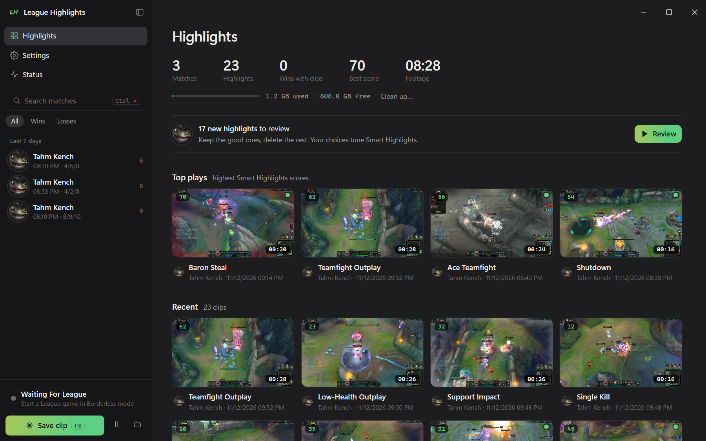
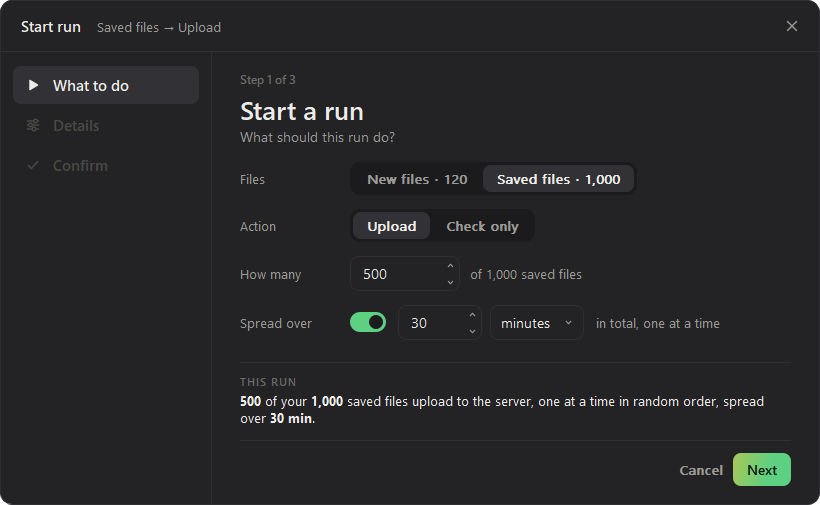
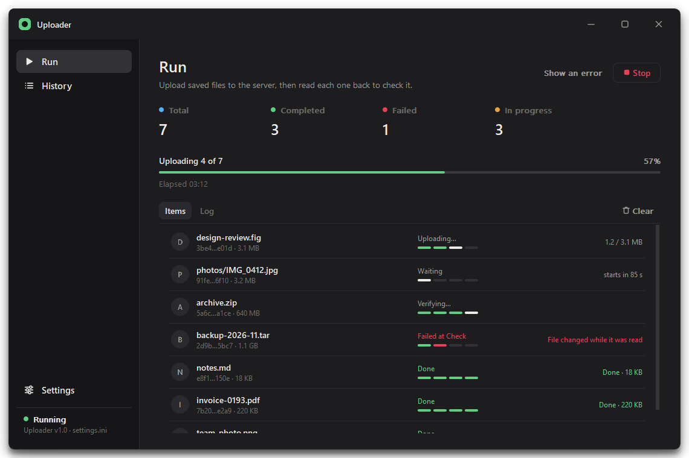

# Quiet desktop UI

A design guide for building flat, calm, dark-first desktop app interfaces in
the style of [League Highlights](https://github.com/Kirbyy1/League-Highlights).

Read **[DESIGN.md](DESIGN.md)** for:

- colour tokens, typography, layout and components
- patterns for tools that run long jobs: stepped dialogs, time and cost shown
  before the start, live progress rows, honest end lines
- a Qt (PyQt / PySide) section on how the look is built
- a ready-made prompt for AI coding assistants



## Qt kit

[`qt/quiet_ui.py`](qt/quiet_ui.py) is the whole look as one module for
PySide6 or PyQt5. It includes:

- the frameless window with its title bar and sidebar
- flat settings rows with the save state
- the stepped popup
- the error note
- the live run list with step tracks
- inputs for durations, counts and ranges

Copy it into an app unchanged and build the pages from its widgets.

```bash
python qt/demo.py                  # a small uploader built with the kit (made-up data)
python qt/demo.py --shots images   # re-create the screenshots below
python qt/test_quiet_ui.py         # behaviour tests, headless
```

Set `QUIET_QT=pyqt5` or `QUIET_QT=pyside6` to pick the binding.





## Use it as a Claude skill

[`SKILL.md`](SKILL.md) turns this repo into a Claude Code skill. Clone it
into your skills folder, and Claude follows the guide whenever you ask for a
desktop UI:

```bash
git clone https://github.com/Kirbyy1/quiet-desktop-ui ~/.claude/skills/quiet-desktop-ui
```

Run `git pull` in that folder to update it.
