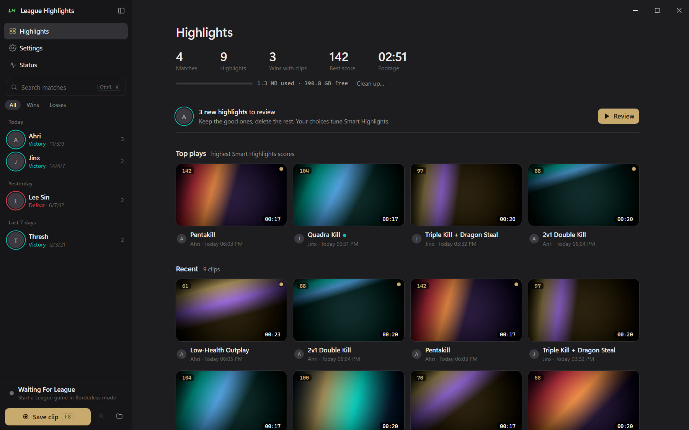

# Quiet desktop UI

A design guide for building flat, calm, dark-first desktop app interfaces in
the style of [League Highlights](https://github.com/Kirbyy1/League-Highlights).

Read **[DESIGN.md](DESIGN.md)**: colour tokens, typography, layout,
components, and a ready-made prompt for AI coding assistants.

